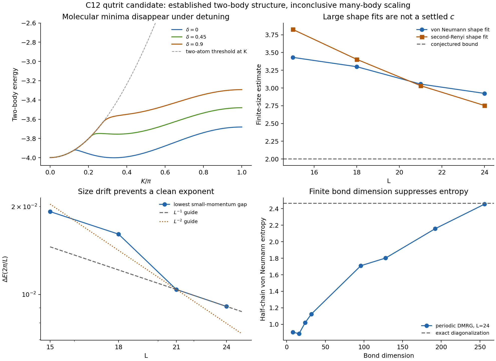

# C12 result

No verified counterexample was found.

The most concrete result is a simple d=3 nearest-neighbor Hamiltonian with an analytically controllable atom band and two bound-pair minima. It provides a possible route to three gapless fluids without cells or a computation track. However, the finite-density points with the largest short-chain entropy estimates do not retain those two molecular minima. Their entropy estimators also fail a size-scaling consistency check. They cannot be reported as counterexamples to c <= d-1.

The elementary cell, ladder, gauge, and squeezed-space implementations screened here did not yield a counterexample either. This is a negative search result, not evidence for a general theorem.

## Explicit qutrit Hamiltonian

Use the on-site states |0>, |1>, |2>, with n=diag(0,1,2) and D=|2><2|. Orient every bond in the same direction. Set

\[
\begin{aligned}
h={}&\frac U2(D\otimes I+I\otimes D)
-\frac\mu2(n\otimes I+I\otimes n)\\
&-(|10\rangle\langle01|+\mathrm{h.c.})
-t_p(|20\rangle\langle02|+\mathrm{h.c.})\\
&-g(|20\rangle\langle11|+\mathrm{h.c.})
+g(|02\rangle\langle11|+\mathrm{h.c.})\\
&+V_{11}|11\rangle\langle11|
+V_{12}(|12\rangle\langle12|+|21\rangle\langle21|)
+V_{22}|22\rangle\langle22|.
\end{aligned}
\]

Then H=sum_i h_{i,i+1} with periodic boundaries is Hermitian, nearest neighbor, and invariant under one-site translation. It conserves N=sum_i n_i. There is no hidden enlarged unit cell or long-range interaction. The signs of the two conversion amplitudes are opposite.

The main numerical family was

\[
g=2,\qquad t_p=10/9,\qquad
U=-14/9+\delta,\qquad V_{11}=0,\qquad V_{12}=V_{22}=20.
\]

The atom hopping is the energy unit. The large-entropy test point delta=9/10 has U=-59/90. For a fully specified exploratory Hamiltonian one can take mu=-157/100. At L=18 this selects N=6 against the tested neighboring charge sectors. Its thermodynamic filling and CFT have not been established. Most measurements below are explicitly canonical, N/L=1/3, and must not be mistaken for proof about the full grand-canonical ground state.

## What is established analytically

At mu=0 the single-atom dispersion is

\[
\epsilon_a(k)=-2\cos k.
\]

For two particles of total momentum K, let c=cos(K/2), s=sin(K/2), and take 0<=K<=pi. After a phase change of the onsite-pair state, the relative-coordinate Hamiltonian has

\[
H_{00}=U-2t_p\cos K,\quad H_{11}=V_{11},\quad
H_{01}=-2gs,\quad H_{r,r+1}=-2c\quad(r\geq1).
\]

All other diagonal entries for r>=2 vanish. At V11=0, integrating out r>=1 gives

\[
E=U-2t_p\cos K+4g^2s^2G(E,K),\qquad
G(E,K)=\frac{E+\sqrt{E^2-16c^2}}{8c^2},
\]

for E below the continuum at that K. The square root is positive. Fix 0<s0<1 and choose

\[
t_p=\frac{g^2(2+s_0)}{4(1+s_0)^2},\qquad
U=-4+2t_p+\frac{g^2s_0^3}{(1+s_0)^2}.
\]

The Schur complement of H(K)+4 is

\[
F(s)=\frac{g^2(s-s_0)^2[(2+s_0)s+s_0]}
{(1+s)(1+s_0)^2}\geq0.
\]

The separated-atom block is positive for K>0. At K=0 its continuum touches -4, the conversion vanishes, and the onsite level lies above -4. Consequently the two-body spectrum never goes below -4, and the molecular minima occur at

\[
Q=2\arcsin s_0,\qquad E_p(\pm Q)=-4.
\]

For g=2, s0=1/2, this is the rational point tp=10/9, U=-14/9, Q=pi/3. The molecular wavefunction has tail x^(r-1), with x=1/sqrt(3). Its onsite residue and curvature are

\[
Z=\left[1+\frac{g^2s_0}{2(1+s_0)}\right]^{-1}=\frac35,
\qquad E_p''(Q)=\frac7{15}.
\]

Thus ma=1/2 and mp=15/7. Relative-coordinate diagonalization through cutoff 160 agrees with the energy, minimum, and curvature. The full derivation, including the derivatives, is in [DERIVATION.md](DERIVATION.md).

This is a quadratic vacuum threshold, with z=2. It is not itself a counterexample.

A three-fluid phase would require finite populations of atoms and both molecular valleys, positive stiffness and compressibility in all three directions, and irrelevant conversion operators. At three decoupled Tonks fixed points, the momentum-neutral vertex 4 theta_a-theta_+-theta_- has dimension 9/2. At Q=pi/3 the three-pair valley-conversion vertex also has dimension 9/2. These reference power counts permit the idea, but do not determine the interacting stiffness matrix or establish that the lattice model realizes that phase.

## A concrete obstruction to the finite-density implementation

Raising U alone does not merely shift a rigid molecular band. It changes the band shape. The molecular minima persist at delta=0.15,0.30,0.45 but disappear in a saddle-node at

\[
\delta_*=0.56981795454,\qquad
Q_*=1.00068764889,\qquad E_*=-3.69864239469.
\]

These numbers solve the stationary-point and zero-curvature equations, with residual 7.8e-13. Direct dispersion scans agree.

Therefore delta=0.75 and 0.9, which produced the strongest entropy signals studied at larger size, do not have the two-body molecular minima required by the proposed dilute-gas argument. A different many-body mechanism would be needed to justify c>2 there. No such mechanism was established.

At the threshold point, ED for three through six particles found no energy below -2N at the sizes reached. This is a useful small-cluster stability check, not a proof against macroscopic collapse or demixing. Comparing opposite- and same-valley two-pair states through L=60 gives very small splittings in favor of the opposite-valley state at the largest sizes. These splittings do not establish a stable thermodynamic valley mixture.

## Central-charge estimators and calibration

For periodic chains the fits use

\[
S_\alpha(\ell)=\frac{c}{6}(1+\alpha^{-1})
\log\left[\frac L\pi\sin\frac{\pi\ell}{L}\right]+b_\alpha.
\]

The von Neumann and second-Renyi shape estimators are three and four times the fitted slopes. Unless stated otherwise, cuts 2 through floor(L/2) are used. Momentum eigenstates are used in ED, avoiding an arbitrary real standing wave of degenerate ±K states.

These are two correlated estimators, not independent proofs. A separate check uses half-chain entropy differences between sizes. For periodic even sizes it gives 3 Delta S/log(L2/L1) and 4 Delta S2/log(L2/L1).

Calibration with the same periodic shape fits gives

| Known model | L | Expected c | von Neumann fit | second-Renyi fit |
|---|---:|---:|---:|---:|
| Free fermions, filling 1/3 | 24 | 1 | 1.0360 | 0.9340 |
| Free fermions, filling 1/3 | 48 | 1 | 1.0187 | 0.9729 |
| SU(3) swap | 12 | 2 | 2.2392 | 1.4839 |
| SU(3) swap | 15 | 2 | 2.1959 | 1.7378 |

Thus finite-size and oscillatory corrections are substantial, especially for the second Renyi entropy. Open-chain calibration was also performed. At bond dimension 192, half-chain size scaling between L=24 and 48 in the SU(3) swap chain gives 2.031 from von Neumann entropy and 2.326 from second Renyi entropy. The XX DMRG energy agrees with the exact free-fermion answer to 1.2e-11 at L=24 and 1.2e-8 at L=48.

For the qutrit chain at delta=0.9 and N/L=1/3, the periodic ED shape estimates are

| L | N | von Neumann fit | second-Renyi fit | Half-chain S |
|---:|---:|---:|---:|---:|
| 15 | 5 | 3.4315 | 3.8252 | 2.223889 |
| 18 | 6 | 3.2999 | 3.4038 | 2.346471 |
| 21 | 7 | 3.0549 | 3.0325 | 2.392796 |
| 24 | 8 | 2.9239 | 2.7532 | 2.464630 |

The L=24 full charge-sector dimension is 5,612,805; its k=0 translation block has dimension 233,920. The lowest k=0 energy is -14.18107312747. The complete momentum check is recorded in the numerical appendix below.

The crucial inconsistency is that L=18 to L=24 half-chain size scaling gives

\[
c_{\mathrm{size},1}=1.2322,\qquad
c_{\mathrm{size},2}=-0.1811.
\]

The negative second value is a failure of this finite-size estimate, not a negative physical central charge. These sizes are not in a common asymptotic scaling regime for both observables. A claim of c approximately 3 based only on the shape fits would be premature.

## Dynamical exponent

At delta=0.9 the lowest k=2pi/L excitation above the k=0 state gives

| L | Gap | L times gap | L squared times gap |
|---:|---:|---:|---:|
| 15 | 0.0192319 | 0.28848 | 4.3272 |
| 18 | 0.0161025 | 0.28985 | 5.2172 |
| 21 | 0.0104060 | 0.21853 | 4.5890 |
| 24 | 0.00910384 | 0.21849 | 5.2438 |

The last two sizes are consistent with a linear mode. Other size pairs exhibit substantial drift and are also compatible with a quadratic crossover. This does not establish z=1 for all proposed modes. It certainly does not identify three independent relativistic branches. In a theory with unequal velocities, the Casimir energy measures sum_a c_a v_a, so substituting the slowest measured velocity into a single-velocity formula would be invalid.

## Why the elementary alternative mechanisms did not work

A fixed injective MPS parent has a bounded D^2 edge ground space once its interval exceeds the injectivity scale. Increasing the cell length alone does not produce more edge flavors. A frustration-free SU(q) ferromagnetic cell does have the large space Sym^b(C^q), but its end generator projects to T^A/b. First-order coupling produces a collective bilinear, not b independent channels or the special higher-degree interaction of an SU(q)_b critical point.

A rigid k-leg rung costs d=q^k and gives c=k(q-1)<=q^k-1. Unrolling it into a spontaneously formed cell leaves the unsolved problem of transmitting all leg channels through one physical boundary. Drawing a nearest-neighbor path as a ladder does not supply the missing leg couplings.

The supplied spin-charge recursion preserves the bound algebraically. Extended molecules can have exponentially many internal words, but ordinary collisions couple their exposed constituents first. Whole-molecule exchange needs additional protection or engineering. Frozen internal words do not contribute CFT central charge.

A naive local Z2 gauge projection also does not compress fermion flavors for free: link gauge qubits restore the Hilbert-space factor removed by the Gauss constraints. Eliminating them changes locality or the allowed hopping. Non-dispersing sectors and translated symmetry-breaking vacua must not be added as independent CFT factors.

[MECHANISM_SCREEN.md](MECHANISM_SCREEN.md) gives the individual arguments and their limits. None is a general no-go theorem.

## Diagnostic figure

## What remains plausible

The qutrit atom-pair route is simpler than the computation-cell construction, but a stable three-fluid phase has not been obtained. A useful next analytic target would co-tune U and tp, or add V11, while preserving molecular minima and controlling atom-pair and valley interactions. Varying U alone through the large-entropy region is not sufficient. Mass imbalance is adjustable within the exact threshold family: s0=1/5, g=6 sqrt(5), tp=275/4, and U=269/2 give mp=ma=1/2. The two-body curvature was checked numerically, but this stronger-coupling variant was not tested as a many-body CFT.

For the cell route, the missing resource is an explicit boundary operator system that accesses many logical modes while the core remains simple. Conventional fixed MPS edges and ferromagnetic collective spins do not supply it. This search does not show that a computation track is necessary, nor does it establish a minimum d for a counterexample.

## Reproducibility and limits

All work was closed book in the supplied directory. No pre-existing project files, papers, or external sources were consulted. Python numerical libraries were used. No sub-agents or cluster jobs were used.

The bond is implemented in qutrit_ed.py. Pair dispersions and the saddle-node are in pair_odd_screen.py, pair_threshold.py, detuned_pair_bands.py, and pair_saddle.py. Translation reduction is in momentum_ed.py. Entropies and momentum purification are in qutrit_observables.py. The DMRG implementation is in simple_dmrg.py, canonical_dmrg.py, and periodic_dmrg.py. The generated JSON files retain raw energies, profiles, residuals, and sweep histories. PROGRESS.md records unsuccessful tests and corrections.

The DMRG implementations were checked against short-chain ED. One early periodic test failed its energy tolerance after six sweeps; twelve sweeps reduced the error to 6e-12. A translation-basis normalization issue caused by float32 square roots of integer periods was fixed and revalidated. Performance changes to tensor contractions were checked against the same energy. These checks validate the implementation at small size, not convergence of every larger run.

## Final numerical appendix

At L=24, all momentum sectors k=0,...,12 were checked. Reality of h gives the remaining sectors by complex conjugation. The lowest state is in k=0, with E=-14.18107312747. The largest reported eigenvector residual in this check is 6.2e-09.

The completed periodic DMRG checkpoints are listed below. These are raw finite-bond-dimension fits, not claims for the thermodynamic central charge.

| L | Largest completed chi | Energy | Half-chain S | Half-chain S2 | Shape fit, vN | Shape fit, Renyi2 | Density range |
|---:|---:|---:|---:|---:|---:|---:|---|
| 24 | 256 | -14.18095565151 | 2.454555 | 1.864485 | 2.9110 | 2.7302 | 0.3295 to 0.3359 |
| 36 | 192 | -21.27165110127 | 1.680674 | 1.014356 | 1.2272 | 0.6464 | 0.2710 to 0.4172 |
| 48 | 192 | -28.35843670102 | 1.827161 | 1.335844 | 0.8680 | 0.4691 | 0.2387 to 0.4617 |

At L=24, the last checkpoint has energy error 0.000117 and half-chain entropy deficit 0.0101 relative to ED. Density modulation and continuing bond-dimension dependence prevent a reliable large-L extrapolation. The interrupted runs and wall-clock stopping condition are recorded in PROGRESS.md.

The nearby detuning delta=0.75 is also affected by momentum and size effects.
At L=21, the lowest tested momentum is k=0, the shape estimates are 3.6497 and 3.7907, and half-chain S=2.660515.
At L=24, the lowest tested momentum is k=8, the shape estimates are 2.4480 and 1.9032, and half-chain S=2.214717.
All sectors were checked at L=21; only k=0,1,4,8,12 were checked at L=24 in this auxiliary detuning scan. Its molecular minima have already disappeared, so this does not rescue the original three-fluid argument.

Numerical environment: Python 3.12.3, NumPy 2.4.6, SciPy 1.17.1. BLAS was limited to one thread per Python process. All random scans use fixed seeds in their scripts.

The run finished in approximately 80 minutes of wall-clock time, with overlapping numerical jobs. All running computations were completed or stopped at their stated time limits. The last completed bond dimensions were 256 at L=24 and 192 at L=36 and 48. Higher requested bond dimensions that did not complete are not reported as results. Reproduction commands are in [REPRODUCE.md](REPRODUCE.md).
