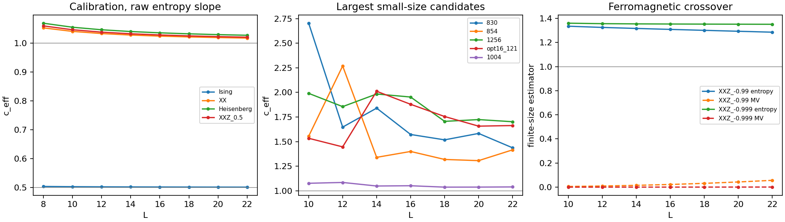

# D2 verdict and numerical results

No scale-consistent counterexample to c_T ≤ 1 has been established. This is a finite numerical search, not a proof of the conjecture. Large entropy slopes are abundant, but the examined outliers do not yet support a common conformal description with stable velocities and justified stress-tensor identification. Some remain unresolved beyond the available sizes.

The largest raw entropy slope found was c_eff=2.703336 at L=10, point 830. Its within-chain regression standard error was 0.118547; this is not a finite-size error bar. The largest L=12 slope was 2.268710 at point 854. Both points were selected for momentum-resolved refinement through L=22.

The largest controlled central charge is still c=1 in the benchmark chains. The four reference models extrapolate to 1/2 or 1 with the conservative sensitivity estimates in calibration.md. No generic point is assigned a central charge above one here.



## Scope

The global scan contains 1338 parameter samples, 138 structured samples and 1,200 random canonical samples, at L=10,12. An additional 159 boundary samples use L=12,14. The pilot is a subset of the global scan and is not counted again. The first local optimization made 340 objective evaluations; the second, at L=14,16 with a finite-momentum velocity penalty, made 130 evaluations.

A total of 212 global points were followed at L=14,16. The velocity screen covers 254 global and boundary samples. There are 16 generic/structured parameter points with completed L=22 refinements, in addition to four calibration chains and the exact and near-ferromagnetic controls. All ground momentum sectors were searched for generic refinements; benchmark momentum and charge assumptions are stated in methods.md.

The pilot follow-up selected c_eff(L=12)>1.12 or initial score>1.02. The subsequent global follow-up selected c_eff(L=12)>1.15 or score>1.05, excluding those already followed. These are screening choices, not physical exclusion criteria. The second optimizer used seeds 883 and 1144 and added 0.4 min(|z_q-1|,5) to the penalty. Every size sequence holds its couplings fixed; optimized couplings were frozen before the larger-L checks.

The structured families are XXZ in a z field, XYZ in a general field, XYZ with DM exchange, uniform Kitaev-Heisenberg-Gamma exchange with a field, and Ising with transverse and longitudinal fields. A uniform symmetric exchange matrix is rotation-equivalent to XYZ, so uniform KHG is a chart of the same family. Alternating-bond KHG would not satisfy the one-site translation hypothesis and was not included.

The boundary grids cover the XY/Ising/saturation meeting near gamma=0 and h_z=2, the XXZ boundaries near Delta=-1 and Delta=1, and DM versus pairing competition near D=gamma, including interacting variants. They locate finite-size crossovers and candidate critical regions, not thermodynamic phase boundaries with certified errors.

## Largest-size diagnostics

The uncertainty after c_eff is the largest of its fit standard error, cut-window spread, and drift across the last three sizes. The half-chain uncertainty includes regression error and changes among the last three, four, or five sizes. These are sensitivity scales, not confidence intervals. z_q is fitted from the average lowest gaps at relative momenta ±2 pi/L over L≥16; its displayed error is only the regression standard error. A conformal tower would require stable gap ratios and z_q tending to one. State changes and finite-size crossings can invalidate this simple exponent fit.

| point | L | entropy c_eff, sensitivity | half-chain scaling slope | z_q | raw c_MV,+ | raw c_MV,- | naive energy c |
|---|---:|---:|---:|---:|---:|---:|---:|
| 1256 | 22 | 1.7023 ± 0.3528 | 1.138 ± 0.747 | 0.089 ± 0.863 | 59.1 | 4.079 | 5.101 |
| opt16_121 | 22 | 1.6635 ± 0.2916 | 0.905 ± 0.272 | 0.904 ± 0.185 | 0.1949 | 5.921 | -1.451 |
| 830 | 22 | 1.4373 ± 0.1987 | 1.247 ± 0.445 | 1.866 ± 2.347 | 6.053 | 0.5027 | 0.985 |
| 269 | 22 | 1.4253 ± 0.0693 | 2.282 ± 1.294 | -2.250 ± 2.662 | 3.89e+04 | 574.4 | -15.612 |
| 854 | 22 | 1.4165 ± 0.1183 | 1.402 ± 0.790 | -0.687 ± 1.618 | 0.9788 | 0.08432 | -8.691 |
| 1144 | 22 | 1.3833 ± 0.2508 | 1.314 ± 0.622 | 1.877 ± 1.215 | 0.5244 | 1.677 | 1.051 |
| 1282 | 22 | 1.3770 ± 0.1395 | 1.165 ± 0.149 | 0.877 ± 0.130 | 2.693 | 0.07829 | -6.513 |
| 1289 | 22 | 1.3406 ± 0.1879 | 0.806 ± 0.435 | 0.576 ± 1.741 | 1.629 | 33.56 | -0.681 |
| 323 | 22 | 1.2800 ± 0.1231 | 0.282 ± 0.079 | 1.751 ± 0.009 | 57.26 | 6.711 | 1.095 |
| opt68 | 22 | 1.2567 ± 0.1747 | 0.974 ± 0.521 | 0.664 ± 1.756 | 0.9399 | 1.029 | -6.575 |
| 220 | 22 | 1.1866 ± 0.1261 | 1.064 ± 1.184 | 1.051 ± 0.927 | 3.053 | 0.601 | -5.577 |
| 871 | 22 | 1.1667 ± 0.0937 | 0.807 ± 0.153 | -0.208 ± 1.285 | 0.5362 | 0.4918 | -2.281 |
| b107 | 22 | 1.1280 ± 0.0595 | 1.002 ± 0.326 | 0.249 ± 0.705 | 0.5061 | 0.2692 | -0.026 |
| 628 | 22 | 1.0729 ± 0.0760 | -0.482 ± 1.451 | 0.038 ± 0.812 | 0.689 | 0.24 | -5.718 |
| 1057 | 22 | 1.0653 ± 0.0418 | 0.997 ± 0.022 | 0.934 ± 0.022 | 0.9477 | 0.7698 | 0.695 |
| 1004 | 22 | 1.0398 ± 0.0318 | 1.010 ± 0.037 | 1.007 ± 0.032 | 1.125 | 1.205 | -4.250 |

The largest raw L=22 entropy slope among these points is 1.702342, at 1256. This is an effective slope, not an identified c_T. The complete size sequences, cut-window comparisons, velocities, and parameters are in candidates.md and the JSON files.

The negative or very large energy and matrix-element entries are diagnostic failures. They are not central charges and are not used as upper or lower bounds. A small gap in a non-stress state can make the proposed matrix-element ratio arbitrarily large. For multiple CFTs, a single selected stress branch would also miss part of c_T.

## Parameters of the raw maximum

```json
{
  "id": 830,
  "J": [
    [
      -0.42619446029019376,
      0.04554816304988314,
      -0.4260119006978927
    ],
    [
      -0.04554816304988314,
      -0.43844423803358334,
      0.35360257059227757
    ],
    [
      0.4260119006978927,
      -0.35360257059227757,
      0.06221018061076293
    ]
  ],
  "field": [
    0.04479218967190924,
    0.054897053227080175,
    -0.006610115507557574
  ]
}
```

## Three checks that prevent an overclaim

1. The exact ferromagnetic boundary has a translation eigenstate with c_eff=1.360032 at L=22. Its energy is E0=-L, every nonzero Fourier energy-density mode annihilates it, and its magnon dispersion is 4(1-cos q), with z=2. The logarithmic entropy does not imply a CFT. At Delta=-0.999 the finite-size entropy slope remains near this value while the Fourier stress estimate is close to zero.

2. The literal left-site-field, largest-overlap prescription selects a non-stress level in critical Ising at the tested sizes. At L=22 it returns 0.873678. Splitting the field equally between the two sites changes no Hamiltonian but selects the stress branch and returns 0.484874, extrapolating toward 1/2. The density improvement and its scaling are derived in methods.md. The main tables use the symmetric density, with the literal-density check retained separately.

3. The naive Casimir fit fails even for a c=1 XX chain at finite density. Exact ring energies at L=8,...,22 give c_E=-0.38670 for h_z=0.3 and c_E=1.71226 for h_z=1.1, using the correct velocity. Particle-number changes add a zero-mode term of the same order as the Casimir energy. The largest single Fourier overlap also oscillates when finite-size curvature splits the conformal multiplet. Consequently, disagreement among the three raw formulas is not by itself proof that a generic candidate is nonconformal.

## What was and was not completed

The ED toolkit, all-momentum resolution through L=22, calibration, structured and random scans, two rounds of local optimization, candidate refinements, and cluster array script were completed. Full-space and momentum-space spectra and Fourier actions agree to about 1e-14 on the independent small-system checks. On-site rotation, density-gauge invariance of H, charge-block entropy, and exact XX-ring energies were also checked. Numerical residuals are saved separately from finite-size uncertainty.

The literal request to take every value above one to L=22 with all three estimators was not completed: 797 of the 1338 global samples already had c_eff(L=12)>1. The local budget was used for staged screening and the strongest or most scale-consistent candidates. The array script extends all global points to L=22. It was written but not submitted. No exhaustive statement about the continuous eight-parameter family is possible from these samples.

The nearly degenerate boundary control b43 was completed through L=18. Its slow L=20 calculation was interrupted, with no L=20 result reported, to reserve time for the larger outliers. The boundary-file cluster array can finish it. Two earlier implementation/calibration failures and their superseded files are identified in README.md.

The remaining scientific uncertainty is located at the extrapolation and conformal-family identification, not at the small-system matrix construction. Longer chains, zero-mode-aware spectral fits, and independent tensor-network checks are needed for the unresolved candidates. No theorem or numerical exclusion of c_T>1 is claimed.

All files were created in the current directory. No pre-existing project files were read or listed. The local elapsed time and process completion record are in STATE.md.
