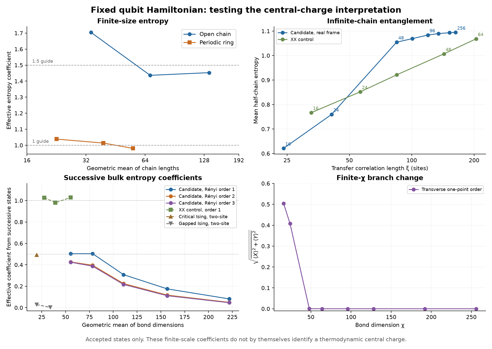

# Bulk central-charge test of the R=8.75 candidate

OpenAI Codex, GPT-6 family, 2026-11-10. Numerical research with algebraic
cross-checks; no human or independent-agent review is claimed for this pass.

**Assessment:** the open-chain coefficient near 1.45 cannot presently be
identified as a thermodynamic central charge. The infinite-chain
coefficients decrease from about 0.50 to 0.31, 0.18, and 0.082 as the bond
dimension increases, while the periodic-ring estimates stay much closer
to one than to 3/2. The evidence favors a gapped crossover over a stable
c=3/2 CFT. It does not establish a nonzero bulk gap or an exact infrared c;
in particular, 0.082 is a finite-scale slope, not a proposed central charge.

The fixed Hamiltonian throughout is

\[
H=\sum_j\left[\frac12(X_jX_{j+1}-Y_jY_{j+1})
+\frac1{10}(X_jY_{j+1}-Y_jX_{j+1})
+\frac58Z_jZ_{j+1}\right]-\frac78\sum_j Z_j.
\]

X,Y,Z are Pauli matrices. Physical sites are qubits, interactions are
nearest neighbour, and the physical Hamiltonian has one-site translation
symmetry. No field or coupling was retuned. The two/four-site infinite-MPS
cells and the alternating on-site computational gauge do not change H.



## Results and interpretation

[Numerical tables](NUMERICS.md) are generated directly from the accepted
records by `analyze.py` and `make_tables.py`. [Raw summary](summary.json)
retains every family separately, including original complex arithmetic,
the exact real gauge, different cell sizes, and one-site refinements.

The prior open-chain estimates are pinned in `inputs/`: the fractional
entropy slopes are 1.43628 at L48→96 and 1.45303 at L96→192. This work
tests whether those slopes measure a bulk CFT, rather than simply fitting
another open-chain profile. The same open L48 state is also recomputed
with the independent TeNPy implementation as a direct consistency check.

For periodic rings at χ192, the fractional-window estimates are 1.01355
from L32→48 and 0.98039 from L48→64. The L64 profile estimates are
0.96658/0.95397 in the middle half/quarter. Both parities pass every
gate at L32,48,64, and the even state has lower energy throughout.
Sweep convergence does not remove bond-dimension uncertainty: increasing
χ128→192 changes the even-sector fractional entropy by 0.00228 at L48
and 0.00864 at L64. These are sensitivity checks, not error bounds or a
thermodynamic c=1 assignment.

On the infinite chain, the low-χ states have substantial transverse
one-point order which collapses by χ48. A fit spanning this change is not
a single asymptotic finite-entanglement sequence. It produces a misleading
coefficient above two and is not used to identify c. On the later nearly
symmetric branch, successive slopes and the Rényi-order dependence are
more informative than a single global straight-line fit. All such
coefficients remain conditional finite-scale estimates.

The real-frame two-site sequence has S₁=1.083647, 1.089662, 1.093290,
and 1.094187 at χ96,128,192,256, with ξ=119.635, 134.506, 152.308,
and 162.667 sites. The corresponding successive ordinary-entropy
coefficients are 0.30801, 0.17512, and 0.08183. At the last step the
order-2/order-3 coefficients are 0.04949/0.04628. All these states pass
the unchanged DMRG gates. A separate one-site sequence through χ128
also bends down, with its last coefficient 0.29350. An independent
four-site cell at χ96 agrees with the two-site state within 1.0e-9 in
energy density and 1.3e-5 in entropy. The original complex arithmetic
and the exact real gauge agree at the shared χ48/64 points.

These checks make a normalization error or a single short-lived plateau
an inadequate explanation of the result, but they do not certify the
global variational minimum, exclude a much longer crossover, or rule
out an additional slow mode. A controlled thermodynamic excitation-gap
calculation or an independently converged larger-scale bulk sequence
would be needed to distinguish those possibilities. If a nonzero gap is
established, the infrared fixed point would have c=0; that is a conditional
interpretation, not a measured value from this pass.

The XX control uses the same infinite-chain procedure and gives c=1.00435
on χ24,32,48,64, or 0.99836 on χ32,48,64. Its higher Rényi orders agree
closely. The candidate's different Rényi coefficients and drifting slopes
are therefore not removed by the control calibration.

Additional transverse-field Ising controls distinguish a known c=1/2
critical point from a small, exactly known fermion gap of 0.02. Their
couplings and pre-run protocol are in `ISING_CONTROLS.md`; accepted
entropies, correlation lengths, and energy errors relative to the exact
free-fermion integral are retained in `ising_controls.json` and the tables.
The accepted two-site critical χ16→24 pair gives 0.49138. The massive
control gives 0.02827 and 0.00312 on χ16→24 and χ24→48: entropy can
approach a constant while the finite-χ transfer correlation length still
increases. Larger critical-control runs that fail stationarity remain
excluded; a small energy error alone is insufficient.

[Independent VUMPS refinements](VUMPS_RESULTS.md) recompute infinite
environments at every update and test the final variational tangent norm.
They form a separate sequence with stricter stationarity gates, rather
than replacing failed DMRG points. The preliminary read-only
[tangent audit](tangent_audit.json) motivated this check: stable local
DMRG residuals did not always imply a tangent norm below 1e-7.

Of nine VUMPS records, two pass all gates: the candidate χ64 warm retry
and the critical Ising χ24 check. Seven fail the stricter split/tangent
requirements. The final χ256 warm retry misses only the tangent gate
(1.829e-7 versus 1e-7); its entropy differs from its DMRG source by
2.626e-6. Across all candidate checks, the energy density changes by less
than 4.7e-10 and entropy by less than 3.3e-5. These small changes are
diagnostics, not acceptance certificates. No family has two fully accepted
VUMPS bond dimensions, so no independent VUMPS slope is assigned. This
incomplete stationarity confirmation is an additional limit on the
physical interpretation.

The complete momentum/parity scan at L16,20,24 finds an even k=0 ground
state and an odd k=0/π doublet. Four-level solves in the ground-state
momentum block find no lower same-block excitation. The odd-even gaps are
0.02130686147, 0.01722003298, and 0.01449702172. These are finite-ring gaps,
not a thermodynamic gap extrapolation. Larger-ring differences are in the
tables only when both independent energy gates pass.
The matched-χ192 differences at L32,48,64 are 0.0110860711,
0.0076620904, and 0.0059414244. Their products with L rise from 0.35475
to 0.36778 and 0.38025, but these sizes do not establish a positive
infinite-volume limit.

A conditional energy/velocity fit on L12–24 gives coefficients near 0.98,
with the identical XX calculation near one. This assumes that the lowest
even-sector ±2π/L states are the appropriate sound descendants and that
one velocity exhausts the Casimir term. The complete spectrum does not
establish those assumptions or rule out additional slow sectors. See
`spectrum_analysis.json`; this fit is not an independent c=1 identification.

[An exact antiunitary symmetry](SYMMETRY.md) explains the odd-sector
doublet: A=VK with V=product exp[i(-1)^j πZ_j/4] obeys A²=1 and
TAT⁻¹=PA. Odd momenta are paired as k↔π−k. Superpositions within the
degenerate pair can change interval entropy without changing energy,
which is why parity-energy and entropy acceptance are kept separate.

## Estimators and convergence

For the von Neumann entropy, the size-pair prefactors are 6 for open
chains and 3 for rings. Fractional-window means use cuts in [3L/8,5L/8]
with linearly interpolated endpoints; central-three means are also kept.
Profile fits use the middle half and middle quarter. Infinite-chain
entropies are averaged over the computational cell, and ξ is the largest
transfer correlation length in physical-site units. The bulk Rényi
estimator is

\[
c_\alpha^{\rm eff}=\frac{12\alpha}{\alpha+1}
\frac{\Delta S_\alpha}{\Delta\log\xi}.
\]

These conditional formulas follow the entanglement results of
[Calabrese and Cardy](https://arxiv.org/abs/hep-th/0405152), their
[review](https://arxiv.org/abs/0905.4013), and
[Pollmann et al.](https://arxiv.org/abs/0812.2903) for finite-entanglement
scaling. A small fit residual alone does not establish their applicability.

The final analysis applies the following common DMRG gates to every
state; the larger-size and larger-χ extensions did not relax them:

- Last four recorded energies span less than 1e-8 per site for infinite
  runs, or 1e-7 in total energy for finite runs.
- Last four recorded mean entropies span less than 1e-5.
- The explicitly measured final local untruncated Ritz residual is below
  1e-8. Reaching a Krylov iteration limit is retained separately and is
  not by itself either a pass or a failure.
- The returned state's norm before our explicit canonicalization, and the
  separately recorded final-sweep norm error, are below 1e-5. TeNPy may
  already canonicalize before returning; that does not erase a failed
  sweep-norm check.
- Returned energy agrees with the independently contracted energy within
  1e-7 per site for infinite runs or 1e-8 total for finite runs.

Three early validation records predate an explicit final-sweep norm flag.
`analyze.py` reconstructs that flag from their saved sweep statistics;
`audit.py` independently checks it. Their raw records are preserved.

Fixed-χ one-site refinement removes recurring two-site truncation from
the variational optimization. It must earn the same acceptance gates;
two-site and one-site infinite sequences are never silently combined.
The parity-energy gate omits only the entropy-stability requirement, and
such an energy-only state cannot enter an entropy fit. If a lower
energy-gated parity lacks an accepted entropy, that size is excluded from
the selected entropy series. Finite-χ variational energy differences are
not rigorous bounds on physical gaps.

TeNPy checks the sweep limit at iteration boundaries and may report one
additional check block beyond the nominal `max_sweeps` setting. Both the
requested option and actual sweep counts are retained in every record.

VUMPS checks use four-record energy/entropy spans of 1e-8/1e-5,
returned-state and final-sweep norm errors below 1e-7, split error below
1e-7, independently recomputed tangent norm below 1e-7, and agreement
among returned, direct, and both environment energies within 1e-8.
These final-state checks are recorded separately from the DMRG gates.
The engine's UniformMPS implementation is marked experimental by TeNPy;
failed split or tangent checks are retained and excluded. The exact
criteria and bounded warm-retry condition are in `VUMPS_AMENDMENT.md`.

## Validation and provenance

The literal Pauli Hamiltonian is checked against an independent full-space
ED implementation: L8 even energy/entropy agree to about 1e-13/1e-14, and
L16 agrees within 7e-11 in energy and 2e-8 in the entropy profile. The L8
odd ground state is exactly degenerate, so comparing arbitrary individual
eigenvector entropies is invalid. The real and original gauges agree at
L8 to rounding error. Momentum-space matrices intertwine with the
independent full-space matrices in every L8 parity/momentum block to
1.6e-14. Antiunitary spectral pairings agree through L24 within 2.4e-13.
The independent open L48 calculation passes every gate and matches the
prior solver within 3.1e-9 in energy and 8.6e-7 in both entropy windows.
The discrepancy between finite-size and bulk trends is therefore not
explained by an implementation or normalization mismatch at that size.
The post-hoc [energy comparison](energy_boundary_check.json) also finds
that (E192−E96)/96 lies 4.33e-6 above the infinite χ256 energy density.
Assuming E(L)=eL+b+a/L on the three largest open sizes puts e within
1.35e-6 of that value. This supports energy consistency across boundaries;
it does not establish the assumed correction form or global optimality.

`PROTOCOL.md` was written before the new production runs. Dated amendment
files preserve the order and reasons for adaptive extensions. Earlier
data are pinned from commit 7014ef41, subsequently rebased to 367f2e69
while an unrelated shared-checkout operation completed. No source or data
from that operation was overwritten. Every executed runner version is
hash-archived in `source_snapshots/`, including the frozen original TeNPy
model and the independent Pauli ED code.

An early options-dictionary serialization bug affected completed
optimizations. Their final checkpoints and failure logs survive, with
records explicitly marked `postprocessing_failed`; independently recovered
observables in `recovered_measurements.json` are not convergence
certificates. Fresh retries/refinements have their own records. The open
cross-check also has a retained model-construction failure before any
optimization, followed by a corrected restart. Failed or unfinished
records are listed in the numerical tables and excluded from accepted
fits.

The DMRG inventory contains 74 completed result records: 45 pass every
gate and 29 fail at least one. Four additional records have the preserved
postprocessing failure described above. The separate VUMPS inventory and
its stricter acceptance decisions are in `VUMPS_RESULTS.md`.

Checkpoints are durable workspace files in `checkpoints_local/`, ignored
by Git. Completed result records contain their SHA256 hashes. Immutable
warm-start snapshots are separately hashed and are not accepted data.
`audit.py --final` verifies the checkpoint metadata, all three entropies,
source snapshots, acceptance arithmetic, energy offsets, warm snapshots,
and absence of unfinished result records. No cluster job or remote
publication is part of this continuation.
All numerical workers launched for this pass have finished. The final
audit reports no provenance or acceptance-arithmetic errors, while
retaining the failed convergence decisions. `manifest.json` records the
artifact and local-checkpoint hashes; `manifest.py --verify` checks them.

## Reproduction

The computations use TeNPy 1.1.1 and one BLAS thread per worker. Each JSON
record carries the full command configuration, engine options and source
hashes. New results are written atomically. To reproduce a past runner
version, restore its archived bytes as `run.py` in an isolated copy of
this directory with the corresponding frozen sources and required input
checkpoint; do not overwrite existing results. A known serialization
failure is a failed record even if its checkpoint can be read.

From this directory with the same Python environment:

```sh
python validate.py
python validate_spectrum.py
python validate_symmetry.py
python validate_crosschecks.py
python energy_boundary_check.py
python control_analysis.py
python analyze.py
python make_tables.py
python analyze_vumps.py
python spectrum_analysis.py
python plot.py
python audit.py --final
python manifest.py
python manifest.py --verify
```

The archived raw data and failed runs are part of the result. Neither the
open-chain entropy excess nor an isolated half-unit bulk slope establishes
a counterexample or a new conformal field theory.
