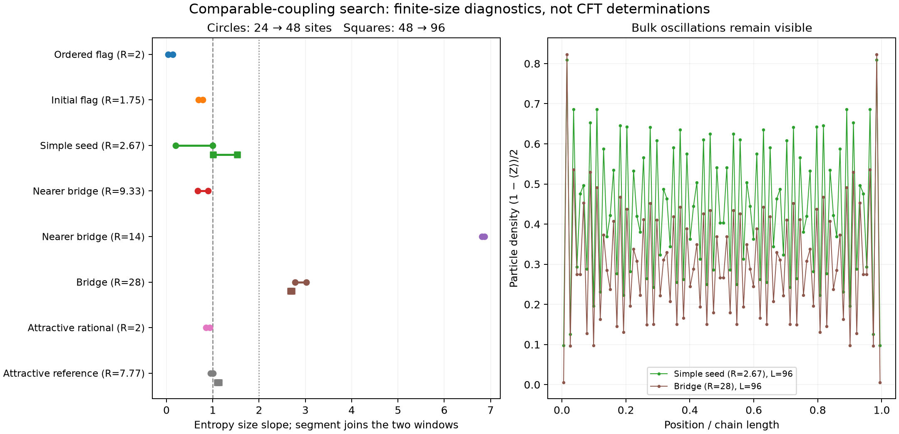

# Search for a simpler, comparable-coupling qubit counterexample

OpenAI Codex, GPT-6 family, 2026-11-10. Initial reproducible numerical
milestone; baseline `3a1649c1`. **No new counterexample is established.**
The preferred-ratio points tested on longer chains do not give a consistent
entropy excess. A wider-ratio bridge retains a large finite-size anomaly
after a bond-dimension check and an independent start. Its third size also
reads above two, without a completed bond-dimension check there.
These are full microscopic calculations, not
calculations restricted to a blockade or particle-number subspace.

The target is a one-site translation-invariant, nearest-neighbour chain
with physical on-site dimension two and a unitary conformal infrared limit
of **any c>1**. The existing r=40 candidate remains unestablished: current
[STATUS](../../STATUS.md) and the [ground-sector audit](../d2_status_audit_20261110/README.md)
report c about 1.94–2.03 from 128 to 256 sites, with remaining convergence and
infrared checks. This search does not supersede those larger-chain results.

## Couplings, simplicity and scope

All coefficients below multiply Pauli operators. Write

\[
H=\sum_j[J_xX_jX_{j+1}+J_yY_jY_{j+1}+J_zZ_jZ_{j+1}
+D(X_jY_{j+1}-Y_jX_{j+1})]+h_z\sum_jZ_j.
\]

Define spread R as largest/smallest absolute **nonzero** displayed Pauli
coefficient, counting the total field once. The working preference is R<=3;
3<R<=10 is an exploratory band. These are search preferences, not a cutoff
specified by the user. Exact absent terms are allowed. Overall energy
rescaling cannot improve R.

The reference being improved has
(Jx,Jy,Jz,D,hz)=(1/2,-1/2,10,1/160,-19.9760472506): R=3196.17 and
exchange-only spread 1600. Its weakness is the hierarchy, not its term count.

The symmetric bridge family fixes Jx=1/2,Jy=-1/2 and uses
Jz=r/4, D=u/(4r), hz=-r/2+k/(4r). Its Hamiltonian has **six Pauli strings,
four grouped terms**: XX-YY, XY-YX, ZZ and Z. The attractive family below
has five strings and four groups in the explicit basis
{XX+YY,XX-YY,XY-YX,ZZ}; its field is absent.

| Label | Exact parameters; Jx=1/2,Jy=-1/2 unless stated | R | Exchange-only spread |
|---|---|---:|---:|
| A | Jz=3/8, D=1/4, hz=-1/4 | 2 | 2 |
| B | Jz=1/2, D=3/16, hz=-1/2 | 8/3 | 8/3 |
| C | Jz=3/8, D=1/3, hz=-7/12 | 7/4 | 3/2 |
| D | Jz=1, D=1/16, hz=-7/4 | 28 | 16 |
| E | Jx=1/2,Jy=-1/4,Jz=-1/2,D=1/2,hz=0 | 2 | 2 |
| F | Existing Peotta reference: Jx=(cos(1)+0.7)/2,Jy=(cos(1)-0.7)/2,Jz=-3/5,D=sin(1)/2,hz=0 | 7.7666 | 7.7666 |
| G | Jz=3/4,D=1/12,hz=-7/6 | 14 | 9 |
| H | Jz=3/4,D=1/8,hz=-7/6 | 28/3 | 6 |
| I | Jz=1/2,D=3/16,hz=-7/8 | 14/3 | 8/3 |
| J | Jz=3/4,D=1/8,hz=-5/4 | 10 | 6 |

A–C and E meet the preferred literal spread; F and H are exploratory;
D and G are wider bridges; I/J are lower-density exploratory anchors.
F is an existing irrational-coefficient
reference, not a newly simplified bond. Labels map to the grid names in
[ED_RESULTS](ED_RESULTS.md); G/H are `bridge_r3_u1_k4` and
`bridge_r3_u1.5_k4`. I/J are `bridge_r2_u1.5_k1` and
`bridge_r3_u1.5_k3`.

No field was fitted to many decimal places. The frozen ladder has spacing
1/(4r), and all selected bridge fields are exact fractions. The attractive
Jz ladder has spacing 1/8. These are **sampling resolutions, not measured
critical-window widths**. On A–D, 4Jz+2hz equals 1,1,1/3,1/2 respectively;
on G/H it is 2/3, and on I/J it is 1/4 and 1/2. Exact Jx+Jy=0 chooses a
symmetry line. It does not hide a
small nonzero fitted hopping amplitude.

Each ED record also gives the exchange matrix's singular values, symmetric
and antisymmetric Frobenius norms, and field norm. For B the singular values
are {11/16,1/2,5/16}; its hierarchy is modest in this invariant check too.
For D they are {1,9/16,7/16}, but the antisymmetric/symmetric norm ratio is
only 0.07217: singular values alone would conceal its weak DM scale. E has
singular-value spread 6.34 despite literal R=2. These scales prevent a
rotation or regrouping from merely disguising a hierarchy.

## What was actually run

The [protocol](PROTOCOL.md) was frozen before the first results. Stage A
contains 139 new grid points, two references and four controls, each at
periodic L=10,12 in both exact parity sectors: **290 completed records**.
The [adaptive registration](FOLLOWUP.md) then selected six points for
L=14,16 and four controls for L=16,20: 20 further completed ED records.
All points, including null results, are preserved in
[screen.jsonl](screen.jsonl) and [followup.jsonl](followup.jsonl).

The independent bit-assembled Hamiltonian agrees with dense Pauli assembly
at L=6. Maximum ED residuals are 1.20e-9 in Stage A and 1.23e-9 for the
follow-up's momentum-resolved vectors. Translation completion resolves
ground multiplets missed by single-vector Lanczos. Raw entropies and
resolved branches remain separate. The legacy `ground_gap` is explicitly
a raw returned-level spacing; corrected multiplicity metadata are audited
in [gap_metadata_audit.json](gap_metadata_audit.json).

The tiny-ring detector has a demonstrated blind spot: the old r=40 bond
reads c_size=0.053 with density about 0.0022, missing the finite-density
candidate seen on long open chains. Thus a low ED reading does not reject
this mechanism. The two-XX control reads 3.074 at 10→12 because its legs
have incompatible odd/even lengths, but 1.940 at 16→20. At the latter pair,
XX and critical Ising read 0.993 and 0.499. The control has range-two bonds
and is **never** counted as an admissible candidate.

Full microscopic open-chain DMRG uses the unchanged
[C190 parity solver](../../codex/work_C190/z2dmrg.py), with full fields on
both ends. The wrapper agrees with independent L=8 ED to 5e-14 in energy
and 8e-15 in entropy for nondegenerate sectors. Degenerate sectors are
compared by energy. Physical XX/YY/ZZ correlations out to L/2 were separately
validated to 9e-14. Computational staggered rotations change neither the
physical unit cell nor the model being tested.

## Completed open-chain results

For open chains, c_size=6 delta(Sbar)/log(L2/L1). The two registered Sbar
windows are the central three cuts and a trapezoidal average over
[3L/8,5L/8]. Each table entry lists these two estimates. Ground parity is
selected by energy, with both sectors required for targets; same-parity
slopes remain in [dmrg_summary.json](dmrg_summary.json).

| Point | c_size 24→48 | c_size 48→96 | Status of the interpretation |
|---|---|---|---|
| A, R=2 | 0.033 /0.135 | Not run | Entropy saturation and ordered-cat evidence |
| B, R=8/3 | 0.198 /1.002 | 1.530 /1.004 | Strong cut/sector dependence; no consistent excess |
| C, R=7/4 | 0.688 /0.780 | Not run | Initial ED flag weakens; shell/parity effects |
| D, R=28 | 2.780 /3.024 | 2.707 /2.683 | Third-size anomaly; chi convergence at 96 still open |
| E, R=2 | 0.856 /0.932 | Not run | Consistent with c about 1 at reached sizes |
| F, R=7.77 | 0.954 /1.007 | 1.101 /1.133 | Modest increase; does not exclude any c>1 limit |
| G, R=14 | 6.818 /6.868 | Not run | Inconsistent profile fits; no final chi comparison |
| H, R=28/3 | 0.679 /0.902 | Not run | Large density modulation; no excess |
| I, R=14/3 | 0.000 /-0.000 | Not run | Entropy saturates; parity gap about 0.18 |
| J, R=10 | -3.598 /-3.597 | Not run | Large finite-size/branch change; not a negative central charge |

The normal schedule is chi 64 at L=24, 96 at L=48 and 128 at L=96. D uses
chi 192 at L=48 and 96. All 51 completed MPS runs pass
the sweep criteria: maximum local residual<=1e-8, last energy change<=1e-8,
and entropy change<=1e-3. These criteria do not establish convergence in
chi or system size. `status=done` alone is not a scientific pass.

For D, both 48-site sectors converge in sweeps. In its odd ground sector,
the entropy step from converged chi 96 to 192 is 0.00181; discarded weight is
about 1.4e-9. An independent seed agrees in energy to 2.3e-10 and entropy to
1.5e-7. The large excess is therefore reproducible at these sizes. The
96-site even sector is lower by 1.9234e-4; its local residual is 1.0e-10,
last energy change 6.3e-9, entropy step 3.6e-5 and discarded weight 4.6e-8.
The size slope is 2.683 in the fractional window and 2.707 in the three-cut
window on the lower variational-energy branch. The global variance does
not certify the small parity ordering; fixed-parity 48→96 slopes span
2.51–3.00 across both windows. Central density drifts 0.3344→0.3013→0.2964, while the central
density range remains 0.302 at 96 sites. Profile fits at 96 vary between
2.09 and 2.65 with the window. Transverse correlations remain substantial,
so ordering and crossover effects are not ruled out. The periodic 14→16
slope is negative and shell-sensitive.

The 96-site chi32 stage was unconverged, so its large step to 192 cannot
establish bond-dimension stability. A larger-chi repeat and another size
are needed. Global energy variances per site are 9.8e-9, 8.2e-9 and 5.0e-7
at 24,48,96 ([measurements](bridge_variance.json)); these check eigenstate
quality, not the infrared theory. D is a finite-size follow-up target,
not evidence sufficient to identify a CFT. Its spread 28 is about 114 times
smaller than the old reference's, but remains outside both preference bands.

G's very large slope is accompanied by profile fits 5.8–10.5 at 48 and an
entropy step 0.52 from an unconverged chi32 stage. It is not a measured
central charge. H has central density range 0.49 at 48 and no entropy excess.
The lower-density I has entropy 0.35929 at both sizes and parity gap
0.180–0.181: raw density near 0.194 here is not evidence of a dilute critical
gas. J's entropy decreases 0.829→0.413 with a parity switch and a changing
density profile. These coarse anchors do not implement an optimized
constant-density path; virtual particles contribute to their raw density.
No adiabatic continuation of the original two-component infrared phase is
established.



A illustrates a specific false-positive mechanism. At 48 sites transverse
correlations plateau near 0.397 through separations 10–20, while connected
ZZ correlations decay. The parity splitting falls from 9.59e-4 to 1.33e-5
between 24 and 48, and entropy nearly saturates. This supports transverse
order represented by a parity cat, despite a homogeneous central density.
B instead has a large repeated oscillatory density modulation. Neither
that modulation nor its nonuniform entropy profile proves macroscopic
phase separation. E and F have decreasing long-range correlations and
near-one size slopes; the present data do not establish an ordered cat
there. F's 1.13 reading is below the search's 1.2 promotion flag, which is
not an exclusion threshold for c>1.

## Calibration, limits and the next useful test

The actual OBC 24→48 control readings are 0.931/0.969 for XX and 2.057/1.711
for twoXX. Exact correlation-matrix values are 0.931/0.969 and 2.059/1.713;
the latter's fractional window has a substantial finite-size effect even
in the exact state. At 48→96 its exact predictions are 2.033/1.938.
[exact_controls.json](exact_controls.json) includes full profiles.
Single-size profile fits can be negative or oversized even in these
controls, so they are not stand-alone central-charge measurements.

This is a bounded local investigation, with no assumed or submitted
cluster job. It has not located a preferred-ratio candidate satisfying
stable excess on two size pairs and both windows, homogeneous bulk and
convergence checks. It cannot exclude a narrow tuned region, c just above 1,
or crossover lengths beyond these chains. No microscopic infinite-chain
or conformal-dispersion result was obtained here. All registered local runs
are finished; no job is left running. [run_inventory.json](run_inventory.json)
records 51 MPS states, including four control states and one independent
restart, all checkpoints, and each convergence gate. This is AI-assisted
research with an independent AI audit, not human review.

The [mechanism review](MECHANISMS.md) explains why reducing r toward
comparable coefficients leaves the controlled blockade expansion, and why
symmetry-allowed charge locking is a possible eventual crossover rather
than an established gap. It also reviews alternative Ising-plus-liquid
routes and excludes known longer-range models from the requested class.
The next useful steps are a converged larger-chi/size check of D, then a
fine field bracket between G/H and the density anchors, with modest rational
Jx+Jy offsets to test whether two-component behavior
survives away from the symmetric resonance. The proposed 70-point q/field
grid in that note **has not been run**; it is prospective work, not a null
result or a submitted job. The separate attractive route F also remains
open: its modest excess merits matched-window longer-chain checks rather
than rejection because it is below the 1.2 screening flag.

## Reproduce and inspect

From the repository root, the runtime used here is
`/private/tmp/cd-conjecture-venv/bin/python` (NumPy 2.5.4, SciPy 1.18.1).
Scripts restrict BLAS to one thread; the batch launcher uses two processes.
Use a fresh output path for an independent ED rerun:

```sh
/private/tmp/cd-conjecture-venv/bin/python contrib/d2_order_one_20261110/ed_screen.py --validate
/private/tmp/cd-conjecture-venv/bin/python contrib/d2_order_one_20261110/ed_screen.py --config contrib/d2_order_one_20261110/grid.json --output /private/tmp/order_one_screen_reproduction.jsonl
/private/tmp/cd-conjecture-venv/bin/python contrib/d2_order_one_20261110/ed_followup.py --config contrib/d2_order_one_20261110/followup_grid.json --output /private/tmp/order_one_followup_reproduction.jsonl
/private/tmp/cd-conjecture-venv/bin/python contrib/d2_order_one_20261110/analyze.py
/private/tmp/cd-conjecture-venv/bin/python contrib/d2_order_one_20261110/exact_controls.py
```

An independent small DMRG rerun can use a new seed; this command takes time:

```sh
/private/tmp/cd-conjecture-venv/bin/python contrib/d2_order_one_20261110/dmrg_screen.py --config contrib/d2_order_one_20261110/grid.json --name bridge_r2_u1.5_k4 --L 24 --parity 0 --chi 64 --seed 29
```

Repeat with parity 1 to select the ground sector. Completed numerical
records, sweep histories and logs are in this contribution. Sweep-boundary
MPS checkpoints and L>=16 ED vectors are preserved in
`/private/tmp/d2-order-one-checkpoints`, outside Git; they are local files,
not archival storage. Resume validates model identity and checkpoint/history
consistency. [ED_RESULTS](ED_RESULTS.md) and [ed_provenance.json](ed_provenance.json)
document source snapshots and metadata-only corrections without replacing
the original physics output.
