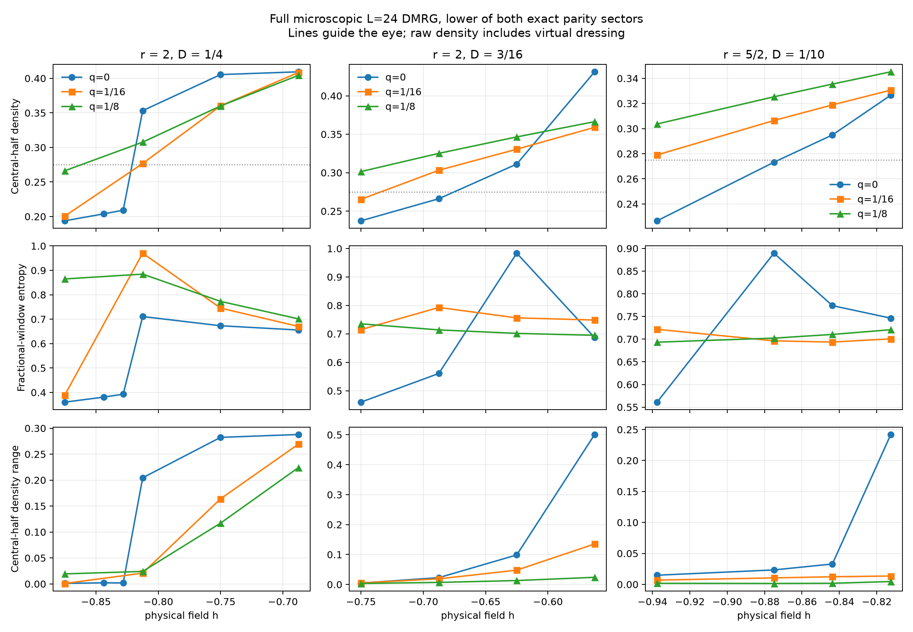
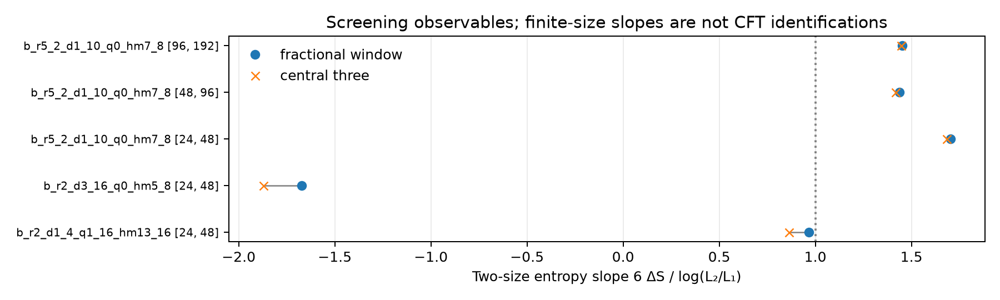

# Comparable-coupling bridge continuation

The promising finite-size candidate has exact couplings `(Jx,Jy,Jz,Dz,hz)=(1/2,-1/2,5/8,1/10,-7/8)`.
Its literal coefficient spread is R=8.75, in the registered exploratory range 3<R<=10. Multiplying the Hamiltonian by 40 gives integer coefficients `(20,-20,25,4,-35)`. It has six expanded Pauli strings, four grouped terms, and the exact relation Jx+Jy=0. This cancellation is disclosed; no basis change is used to reduce the advertised hierarchy. Exchange singular values are 5/8, 3/5, 2/5 (spread 25/16), and the antisymmetric-to-symmetric Frobenius ratio is 0.149854.

The preregistered closest-density rule selected this point from the original L24 grid. The exact same field and couplings are used at every larger size; there is no size-dependent retuning. A surrounding floating phase and robustness to q=Jx+Jy perturbations have not been established.

This is a finite-size numerical lead, not a demonstration of an asymptotic c>1 or conformality. The parent's independent small periodic chains currently look near c=1, so the geometry dependence and remaining size corrections must stay explicit.

| L | chi | central density | density range | fractional S | central-three S | profile c (1/4,3/8) | far XX RMS | both sector sweep gates |
|---|---|---|---|---|---|---|---|---|
| 24 | 64 | 0.27323686 | 0.02331127 | 0.889542555 | 0.901522457 | 2.10242, 1.74094 | 0.36190477 | True |
| 48 | 192 | 0.26771387 | 0.02369620 | 1.086368950 | 1.095905047 | 2.02202, 2.08115 | 0.27553721 | True |
| 96 | 256 | 0.26626282 | 0.00605353 | 1.252294849 | 1.259775717 | 1.51100, 1.55019 | 0.20258214 | True |
| 192 | 256 | 0.26584672 | 0.00237772 | 1.420155010 | 1.426992742 | 1.45393, 1.46296 | 0.14225583 | True |

The chi column refers to the retained lower-energy sector. Both-sector bond dimensions and source records are explicit in `summary.json`.

| Size pair | fractional-window c slope | central-three c slope |
|---|---|---|
| 24→48 | 1.703763 | 1.682609 |
| 48→96 | 1.436283 | 1.418492 |
| 96→192 | 1.453026 | 1.447459 |

| L, parity | chi step | delta E | delta fractional S | delta central-three S |
|---|---|---|---|---|
| 48, 0 | 128→192 | -2.99e-09 | 7.87e-07 | 8.56e-07 |
| 48, 1 | 128→192 | -3.08e-09 | 8.01e-07 | 8.67e-07 |
| 96, 0 | 192→256 | -1.52e-08 | 8.11e-06 | 8.7e-06 |
| 192, 0 | 192→256 | -3.58e-07 | 0.000247 | 0.000261 |

The correlation origin is at site L/4 and endpoints extend through 3L/4; the far-correlation RMS uses the latter half of that separation array. It is an order diagnostic, not a fitted critical exponent. Sector splittings remain variational diagnostics.

The parent independently checked L=64 with both parities at chi192. The fixed-field adjacent slopes are 48→64: 1.447411/1.421012 and 64→96: 1.428387/1.416705 (fractional/central-three). See [intermediate-size records](../independent_sizes/).

The independent periodic 16→20 entropy slope is 1.039646; the L=20 profile estimate is 1.023765. These small-ring estimates remain near one, while the larger open-chain entropy estimates are higher; the difference in geometry and accessible sizes remains unresolved. See [periodic summary](../bridge_ring_summary.json).

## Controls and provenance

The unchanged prior C190 full microscopic DMRG wrapper is imported with new output and checkpoint directories. Both exact parities are solved. Repeated XX and symmetric r2 plumbing controls reproduce the prior energy, entropy and density exactly; see `plumbing_controls.json`. The previous contribution is unchanged.

`PROTOCOL.md` predates all output. `promoted.json` freezes the original six-point promotion. `ADAPTIVE_AMENDMENT.md` separately declares two post-screen safeguards and six finer fields. `R3_EXTENSION.md` declares the ten-field r3 scan and bounded density refinement. `LEAD_VALIDATION.md`, `LARGE_SIZE_EXTENSION.md` and `L192_CHI_VALIDATION.md` declare follow-up checks before their output.

The original grid has 36 Hamiltonians plus plumbing controls; two density bisections were added. Five weak single-size promotions selected for L48, six targeted L24 refinements and ten r3 L24 fields remain unrun and explicitly deferred after the search focused on this lead. These five promotions are untested at matched size, not already ruled out. A DEFERRED log entry is not a computed result.

All completed numerical records, including negative and contradictory results, remain in `dmrg/`; `summary.json` includes field-energy concavity checks. `validation_snapshots/` preserves earlier chi JSON records. The old L96 even chi192 NPZ was overwritten and is unavailable; its raw JSON and pre-upgrade diagnostics remain. All eight final lead states have hash-verified JSON/NPZ snapshots in `final_state_preservation.json`. Later preservation is documented in `STATE_PRESERVATION.md`; the parent also created durable Git-ignored workspace copies, verified by [local checkpoint manifest](../local_checkpoint_manifest.json). No cluster job, commit or push was performed by this scan.

## Other completed matched-size points

| Point | fractional c24→48 | central-three c24→48 |
|---|---|---|
| `b_r2_d1_4_q1_16_hm13_16` | 0.967152 | 0.860955 |
| `b_r2_d3_16_q0_hm5_8` | -1.672501 | -1.872951 |

The near-preferred R3.25 point has smooth density but a size slope near one. The r2,D3/16,h=-5/8 entropy peak decreases at L48 on the lower-energy branch; its high-entropy odd sector is higher in energy. Neither is a positive c>1 lead.

