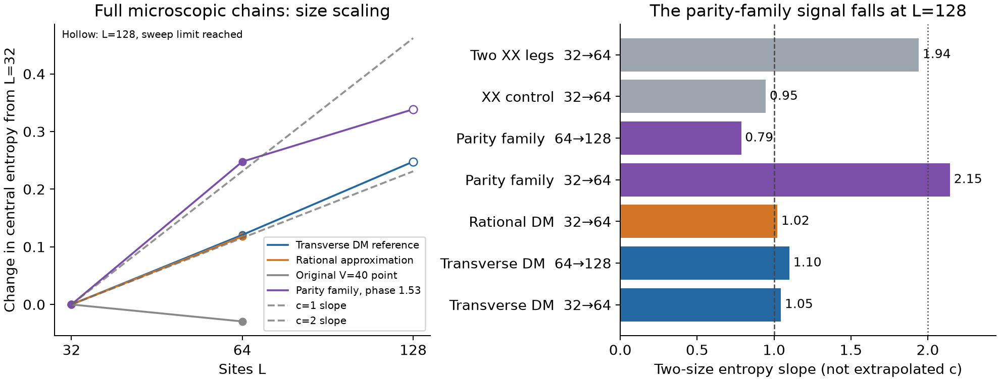

# Full-spin DMRG: transverse-DM and simpler parity-family tests

OpenAI Codex, GPT-6 family, 2026-11-09. No d=2 counterexample is established.
The simpler parity family gives an encouraging c≈2 entropy slope at
L=32→64, but **the completed L=128 test does not sustain it**. Every
64→128 parity pairing reads below one. Those larger states are not fully
optimized, leaving physical crossover versus numerical bias unresolved.
The transverse-DM points instead give provisional readings near one.

The literal microscopic spin chain is used with no blockade projection.
TeNPy's matrices and L=8 ground-state entropies agree with independent
Kronecker-product exact diagonalization (matrix error below 3e-14,
entropy below 2e-12). The C183 L=12 answer also matches the independently
run repository Davidson solver and sparse ED.

For the predetermined estimator c_2=6[Sbar(2L)-Sbar(L)]/ln2, where Sbar
averages three central cuts, the completed L=32 to 64 results are:

| Full microscopic point | Sbar(32) | Sbar(64) | c_2 |
|---|---:|---:|---:|
| C183 transverse DM, hz=-7.9463 | .32228975 | .44301798 | 1.04504 |
| Simple rational transverse DM, hz=-8137/1024 | .35902599 | .47706901 | 1.02180 |
| XX c=1 estimator control | .87804764 | .98741699 | .94672 |
| Two independent XX legs, c=2 estimator control | 1.48793688 | 1.71220998 | 1.94135 |
| Parity family, phi=1.53 (lowest tested parity at each L) | 1.35323214 | 1.60105887 | 2.14523 |

Hollow markers identify L=128 runs that reached their sweep limit. The
parity-family curve flattens substantially in the larger-size test.

The two-leg control is a range-two calibration, not a d=2 NN candidate.
Its largest discarded weight is 1.9e-6 at chi=96, so it calibrates the
large separation of the two readings, not high-precision c. Transverse-DM
candidate discarded weights are much smaller (below 1e-10 at L=32,64).
The C183 L=64 energy changes alternate by about 4e-10 and entropy changes
are below 5e-8; the simple point has changes around 3e-9 and 2e-7. These
are useful numerical tolerances, not rigorous eigenstate error bounds.
The exact free-fermion controls give .946721 and 2.047422 for this size
pair. Thus the two-leg chi=96 result has a downward bias of about .106
in the estimate; the exact comparison is retained in summary.json.

The short-chain c>1 profile fits are not stable: for C183 the central
half fit falls from 2.25 at L=32 to 1.15 at L=64. For the rational
point it falls from 1.99 to 1.01. The two-size readings are close to a
one-mode liquid at these sizes. This does not prove asymptotic c=1,
exclude a narrow nearby c>1 window, or distinguish an eventual gap.
The bulk densities (middle half) change from .1826 to .1716 (C183) and
.2103 to .1956 (rational), so density and boundary effects remain.

At L=128, C183 gives Sbar=.57013151 and c(64 to 128)=1.10032; the
central-half profile fit is .98583. The largest final discarded weight
is about 3e-10, but alternating sweep energy changes remain 5.4e-8 and
mean-entropy changes about 4.8e-6, so this is a provisional finite-size
reading, not a fully certified convergence limit. A different dense
initialization at L=64, chi=64 reproduces the chi=128 energy within
6.8e-8 and central entropy within .000195. The exact corresponding
64-to-128 control estimates are .97227 and 2.02543.

The original V=40 point quoted in the chat is much less entangled at
L=32 (Sbar=.04685, middle-half density .02916) and L=64 (Sbar=.01748,
density .00822). A bounded field scan was subsequently performed; see below.

## Simpler full-microscopic point: short-size signal fails its larger test

Set V=40, Delta=1, w=exp(1.53 i)/80, Dy=0, and hz=-19.97589125:
Jx=(1+Re w)/2, Jy=(-1+Re w)/2, Jz=10, Dz=Im w/2. This is the
ordinary parity family with a small real hop, and contains one fewer
exchange term than the transverse-DM proposal.

Both exact parity sectors were optimized separately; small-L checks of
the selector agree with independently restricted ED. At L=32 the odd
sector has lower energy, and at L=64 the even sector does. The energy
separations are 8.05e-5 and 4.91e-5, respectively. The selected states
give c(32 to 64)=2.14523, and the L=64 profile fits across the four
preselected windows are 2.3985, 2.2288, 2.0504 and 2.3616. This is new
finite-size evidence from the full microscopic chain, not substituted
effective-model data.

Important limitations: the bulk density drifts .25494 to .21826;
the selected parity changes; the L=64 last energy changes are of order
5e-7 and mean-entropy changes about 1e-5 (odd sector 8e-7 and 1e-4).
The final discarded weights are below 2e-9, but small discarded weight
alone does not certify local eigensolver convergence or the global
ground state. No extrapolated c, gapless theorem, or counterexample
claim follows. The independent effective-model evidence and its
assumptions are audited in ../d2_priority_audit_20261109/.

Both L=128 parity runs have now returned:

| Parity | Shifted energy | Sbar | Middle-half density | Central-half profile c |
|---|---:|---:|---:|---:|
| even | -3.199287936003 | 1.68631521 | .22006166 | .74875 |
| odd | -3.199296931209 | 1.69191583 | .21392232 | 1.07585 |

The nominal lower-energy selection gives c(64→128)=**.78647**. Every
other parity pairing also gives a value below one (.738–.931); the
negative result cannot be removed by changing parity selection. The
interior density stays smooth and changes modestly. Both profile and
size-growth estimates fall, so this is a substantive negative follow-up.

There is a specific unresolved convergence problem, not a positive phase
claim: both runs hit their sweep cap at chi=128. The even branch's last
mean-entropy change is .00405 and energy change 5.77e-6, comparable to
the 9.00e-6 parity splitting. The odd mean-entropy change is 7.57e-5;
both retain entropy-profile reflection defects. The final canonical
norms are around 1e-14, which verifies normalization, not optimization.
Recovering c=2 would require about **.1402** additional central entropy
at L=128. No error bound establishes or excludes that correction.
See `REVIEW.md` for all sector pairings and convergence measurements.
The [next-test protocol](../d2_priority_audit_20261109/NEXT_STEPS.md)
therefore keeps this Hamiltonian fixed, resolves local solver error first,
and then compares larger bond dimensions with saved state checkpoints.

The nearby exact rational simplification is

\[
H=\sum_j\left[10Z_jZ_{j+1}+\frac{X_jX_{j+1}-Y_jY_{j+1}}2
+\frac{X_jX_{j+1}+Y_jY_{j+1}}{4000}
+\frac{X_jY_{j+1}-Y_jX_{j+1}}{160}\right]
-\frac{199759}{10000}\sum_jZ_j.
\]

It removes transverse DM and uses only rational coefficients. It retains
the small real hop that offsets the effective valleys; setting that hop
to zero would change the mechanism. This is a test candidate, not an
established counterexample. Independent Davidson results and their
measured local residuals are recorded in
[`SIMPLE_PARITY_CANDIDATE.md`](../d2_dmrg_priority_20261109/SIMPLE_PARITY_CANDIDATE.md).
Both independent sectors are complete at L=32 and 64. Their lower computed
energies give Sbar=1.35324023 and 1.59917937, hence c_eff=**2.12889**.
The L=64 profile fits span 2.05–2.37, reproducing the intermediate-size
signal with a different solver and rational coefficients. The registered
local residual target 1e-8 fails: maxima are about 1.1e-6 at L=32 and
1.18e-5/2.16e-5 at L=64. Thus this is useful replication, not a converged
central-charge determination, and it does not reverse the nearby
unrounded model's negative L=128 test. All scheduled runs are complete.

## Original V=40 field scan

The registered three L=32 fields are -19.9771875, -19.9768875 and
-19.9765875, keeping every exchange coefficient fixed. At the latter
two fields Sbar is .34684 and .41195, respectively, with middle-half
densities .22199 and .26960. The first field was refined to chi=96 and
extended to L=64: Sbar changes .30355→.80242 while the middle-half
density nearly halves, .13437→.07081. Its L=64 profile coefficients
range from **4.05 to 14.58** across the registered windows. These very
large, inconsistent fits are not evidence for a large central charge:
few-particle/boundary structure and incomplete optimization dominate.
The raw profiles and histories are retained as `original_field_*.json`.
No stable c>1 regime was demonstrated by this bounded field scan.

## Infinite-chain diagnostic of the transverse-DM point

Initial infinite-chain attempts had defective environments and unusable
energies/correlation lengths. Their failure records are retained and
excluded. A coherent blockade-gas initialization and corrected
environments subsequently found a lower-energy liquid branch, without
projecting the Hamiltonian. The chi=32→64 entropy/correlation-length
proxy is 1.04635; an independent ARPACK local solve changes it to 1.04667.
This is consistent with the near-one finite-size reading, not a
converged finite-entanglement central charge. The chi=64 checkpoint
has local residual 1.48e-5, and further sweeps/bond dimensions were not
completed. See `INFINITE_LIQUID_BRANCH.md` for reproducible methods,
failed attempts, and the remaining global-optimization limitations.

The rational Hamiltonian and independent small-ring comparisons are
in ../d2_simplification_20261109/. A separate exact finite-ring series
shows the surviving antiunitary allows a very small uniform Y source;
it does not establish relevance or a gap. See the corresponding audit.
