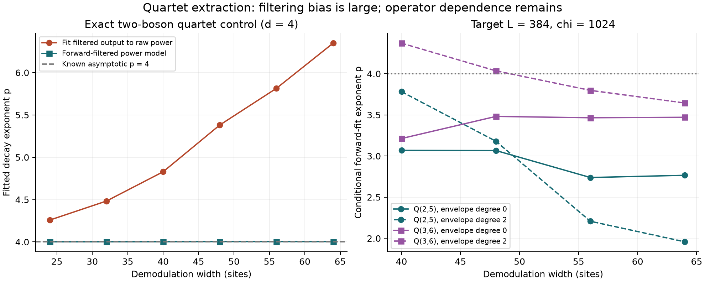

# IAS quartet pilot and estimator audit

2026-11-25. **[Numerical; bounded pilot and audit.]** The historical six-file quartet
table reproduces exactly, but its quoted `x4 approximately 2.05 +/- .2`
does **not** include a substantial local-filter bias. That estimate is
not a calibrated charge-four dimension. The new data do not establish
quartet locking or asymptotic stability of the qubit candidate.

## Claim and hypotheses

The target is the Hermitian, one-site translation invariant nearest-
neighbour physical-qubit (`d=2`) Hamiltonian

    H = sum_j [(19/32) X_j Y_(j+1) + (13/32) Y_j X_(j+1)
               + Z_j Z_(j+1)] - (1783/1000) sum_j Z_j.

Every open-chain site receives one full field. Delta=3/16 and h=1.783
are fixed. The real computational frame is the site-dependent z rotation
theta_j=j*pi/2; it shifts pair momentum by pi and quartet momentum by zero.
Only spin parity is exact. A lattice quartet monomial need not be an
emergent charge-four primary. The desired CFT is unitary and compact and
its central charge is Virasoro c; finite entropy slopes do not identify it.

## Saved-data audit

The original compressed data and scripts are unchanged. The exact
[reproduced table](analysis/historical_table_reproduced.txt) is followed
by 12,672 deterministic variations in [sensitivity.csv](analysis/sensitivity.csv):
window widths 24,32,40,48,56,64, harmonic orders 1,2,3, each reference
position separately or their mean, and five distance windows. Further
[calibrations](analysis/calibration_sensitivity.json) vary the fitted
momentum by up to .002*pi and allow linear/quadratic harmonic envelopes.
Overlapping windows are **not independent statistical samples**. Fits to
log magnitudes are suppressed on sign-changing data; signed residuals
are retained. The historical table itself used log absolute values even
for some sign-changing control data.

At L=384, chi=1024, width 48 and r=32–56, the individual-reference
Q(2,5) slopes range from 3.727 to 4.061. For Q(3,6) they are 5.299,
3.830 and a sign change (no log fit), versus 4.313 after reference
averaging. Merely adding the next constant-amplitude harmonics changes
these averaged slopes by less than .0002; reference position, window
width and amplitude-envelope modelling are the material sensitivities.

The local Hann filter averages a rapidly varying amplitude over 48
sites before assigning it to the centre. Thus fitting the output to
an unfiltered power law is biased, even at zero numerical noise.
For a symmetric normalized kernel with second moment mu2, the expansion
is `filtered(r^-p) = r^-p [1 + p(p+1) mu2/(2 r^2) + ...]`; the correction
itself changes the slope. Here the window is too wide relative to r to
rely on that leading expansion, so the calibration applies the full
discrete kernel to every trial power.
For Q(3,6), the first fitted centre is r=33.5 but its kernel uses r=10–57,
including separations barely beyond the operator's nine-site span. A
forward pure-power correction assumes that power over the whole kernel
support, not just r=32–56; short-distance corrections remain a further
limitation on applying the calibration to the target.



The right panel shows conditional curve fits, including unstable
sign-changing variants. It is a sensitivity display, not a distribution
of independent measurements or an identified charge-four exponent.

| Signal, with the historical 48-site filter and r=32–56 | True p | Naive output p | Forward-filtered power fit p |
|---|---:|---:|---:|
| Pure power plus rank-one neutral part | 3.68 | 4.8459 | 3.6800 |
| Pure power plus rank-one neutral part | 4.00 | 5.3763 | 4.0000 |
| Exact infinite XX x XX quartet | 4.00 asymptotically | 5.3812 | 4.0040 |
| Exact OBC XX x XX, L=256 | 4.00 asymptotically | 5.5913 | 4.0880 |
| Exact OBC XX x XX, L=384 | 4.00 asymptotically | 5.4684 | 4.0400 |
| Exact infinite XX x XX pair | 1.00 asymptotically | 1.1119 | 1.0000 |

Here `p=2x` only after a scalar operator is matched. The exact two-boson
control consists of two independent XX chains per site, with microscopic
**d=4**, hopping tA=1,tB=.7 and zero fields (unequal velocities). For
`Q_i=(Sm_A_i Sm_A_(i+1))(Sm_B_i Sm_B_(i+1))`, Wick's theorem gives
`G_Q(r)=[C(r)^2-C(r-1)C(r+1)]^2`, where
`C(r)=sin(pi*r/2)/(pi*r)` in the infinite half-filled chain. Finite OBC
values use the exact occupied sine-wave projector. This is a calibration,
not a d=2 construction. The h=1.772 qubit control is retained from both
original chain lengths.

The control pair `Sm_A_i Sm_B_i` uses the squared XX transverse-spin
Toeplitz determinant. The one-chain adjacent-pair Wick formula and the
transverse determinant independently agree with an L=8 dense ground-state
calculation within 3e-16 (`free_control_validation.json`).

Applying only a pure-power forward correction to the high-chi L=384
target gives p=3.067 for Q(2,5) and 3.481 for Q(3,6). These are conditional
curve parameters, **not replacement x4 measurements**: a quadratic
harmonic-envelope filter moves Q(3,6) to p=4.035, with sign changes and
larger residuals. Shape, envelope, reference, window and chi dependence
are not controlled to .05 in x. Simply increasing chi cannot repair this
identification problem.

Synthetic tests include data-scale oscillations and multiple independent
neutral components. Two neutral r^-4 components can exactly reproduce
the isotropic two-quadrature covariance of a charged r^-4 vertex. This
is an explicit nonidentifiability example, not evidence that the target
actually has those neutral components. The rank-one neutral assumption
must be tested with enlarged operator measurements and further matching.

## Pilot and validation

The authorized IAS run `quartet-pilot-20261125a`, Slurm **17764244**,
completed with exit 0:0 in 50 min 58 s. The request was 4 CPUs, 16 GB,
one hour, L=128, even parity, chi=64,128,256,384,512. It reached chi256,
saved a partial checkpoint at its conservative deadline, and did not run
chi384/512. No unavailable historical MPS was assumed.
Each stage saves an atomic HDF5 checkpoint in the remote `states/` directory,
outside fetched `results/`; earlier stages are preserved. The new engine
uses the original `ofd.py` model, initializer and solver settings, with
one-sweep statistics and a conservative deadline. Resuming rebuilds the
environment from the saved MPS and resets mixer/sweep counters; it is a
variational warm restart, not a bitwise engine continuation.

| L128 even target stage | Energy | Midpoint entropy | Central-quarter mean entropy | Sweep-converged? |
|---|---:|---:|---:|---|
| chi64 | -133.56333751015325 | 1.682258 | 1.596542 | No; 41 sweeps |
| chi128 | -133.56423306491507 | 1.831550 | 1.754995 | Yes by stopping tests; 29 sweeps |
| chi256 | -133.56448160561783 | 1.831076 | 1.867337 | No; deadline after 24 sweeps |

At chi256, the last |Delta E|=1.473e-6 and |Delta S|=.006754 exceed
the requested 1e-9 and 1e-5. The saved midpoint entropy exceeds the
old rounded same-chi value 1.75439 by .07669. Even the sweep-converged
chi128 state differs from its old same-chi midpoint entropy by .16107.
Thus this is not matched-reference certification of the target.
The final energy is 2.0154e-5 above the old chi1024 value, an unmatched-chi
comparison that cannot certify either the state or its tiny correlators.

Slurm records 509872 KB peak memory and 3 h 21 min 35 s TotalCPU;
the process records a 542.10 MiB maximum RSS. The 1/4/8-thread diagnostic
did not successfully vary MKL's observed thread count, so it provides no
speedup estimate. Measured memory is inexpensive at these chi values;
it is not a high-chi memory or runtime forecast.

- Literal original/rotated MPO agreement and full end fields: below 2e-15.
- Random complex L=12 parity-state correlators: below 3e-16 (shortened
  quartet shapes make a dense-vector test possible).
- Exact production quartet offsets, L=24 complex parity cat: 704 matrix
  entries agree with independent local-matrix contractions within 7e-16.
- HDF5 roundtrip: vector error below 4e-16, energy unchanged.

The enlarged raw matrix keeps Q(2,5), Q(3,6), their adjoints, Z, ZZ and
both nearest-neighbour hopping orientations. Hermitian quadratures can
be formed afterwards. Candidate-neutral probes are labelled as candidates;
their continuum charge is not assumed. Finite-distance correlation matrices
are not necessarily positive semidefinite Gram matrices.

The first centre-aligned follow-up, Slurm 17764302, completed in 110 s
with exit 0:0. It shifts the two quartet shapes to have centre i+1/2
and uses `(Z_i+Z_(i+1))/2` alongside ZZ and hopping quadratures, retaining
nine raw monomials. Independent checks of the 648 additional entries
agree within 3e-16. At target L128, chi128, a fixed subtraction of the
imaginary hopping quadrature changes the smaller Q(2,5) signal by 117%
and 91% at the two references (width 32; L2 change over all available
filtered centres), and Q(3,6) by 38% and 15%. Sign changes and strong
reference dependence remain. Similar sensitivity occurs in the c=1
control. This is a finite-size basis-sensitivity diagnostic, not a proof
of multiple neutral primaries in the target or a projection onto charge
four. The short, incompletely chi-converged target cannot support that
identification.

The c=1 control completed through chi256 in 14 min 18 s, exit 0:0,
Slurm MaxRSS 568092 KB. At chi256, E=-133.2253186480565,
Smid=.75457451 and central-quarter Sbar=.85210734. Smid agrees with
the rounded same-chi .75457. From chi128 to 256, the Q(2,5) smaller
filtered signal still changes by 4.6% (width 32, reference 47, r=24–44),
despite energy changing only 1.2e-7. This illustrates why energy alone
is insufficient for the tiny quartet correlator.

The final read-only chi256 measurement, Slurm **17764463**, retains all
pair/quartet normal and anomalous correlators plus the centred enlarged
matrix. It completed in 6:32, exit 0:0, with Slurm MaxRSS 238904 KB.
All repeated pair/quartet arrays from the unchanged control checkpoint
agree exactly with its first measurement. Comparing chi128 to the
partial chi256 target at reference 47,
width 32 and r=24–44 gives relative L2 changes of **280%** for the
smaller Q(2,5) signal and **93%** for Q(3,6), using the new-state norm in
the denominator. The two pair channels change by 20% and 44%. The fitted
kappa/pi shifts from .20445 to .20680. Holding kappa fixed at either
value leaves the two quoted quartet changes essentially unchanged.
The target checkpoint's parity is +1 within 3e-15 and its canonical-form
norm-test error is 3.4e-14; serialization corruption does not explain
these differences. The warning in the optimizer log describes the state
before its final canonicalization.

At chi256 the centred-matrix subtraction diagnostic remains reference
sensitive: the same imaginary-hopping subtraction changes the smaller
Q(2,5) signal by 37% versus 6% at references 47 and 56, and Q(3,6) by
138% versus 5%. These use width 32, weights fitted over r=24–40 and an
L2 change over all available filtered centres. They are not rank bounds,
charge projections or primary dimensions.

**Scale-up decision:** no L256/384 chi1024–2048 jobs or L512 jobs were
launched. Correct Hamiltonian and correlator implementations, retained
checkpoints and adequate measured memory passed. Target convergence,
matching to old same-chi references, and the charge assignment/extraction
systematics did not. Neither parity sector has new large-L production
data here. The requested uncertainty near .05 in x4 is not achieved;
locking versus irrelevance remains unresolved. A further optimization
campaign would first need a reliable fixed-L convergence protocol and
an estimator that distinguishes the charged operator from neutral terms.

## Reproducing

Requirements: numpy, scipy, h5py, physics-tenpy==1.1.1, threadpoolctl;
matplotlib for the calibration figure.
The verified IAS environment is documented in the [runbook](../../tools/typhon/README.md).
Saved-data analysis ran in an isolated temporary Mac environment; sustained
optimization runs only on IAS. The initial six-file audit took 6.8 seconds.

From the repository root:

```sh
python contrib/quartet_typhon_20261125/audit_saved.py
python contrib/quartet_typhon_20261125/audit_calibration.py
python contrib/quartet_typhon_20261125/validate.py --output /tmp/quartet-validation.json
python contrib/quartet_typhon_20261125/validate_production_ops.py --output /tmp/quartet-ops.json
python3 tools/typhon/typhon.py submit FRESH-RUN-NAME contrib/quartet_typhon_20261125/pilot.job.json
python3 tools/typhon/typhon.py status FRESH-RUN-NAME
python3 tools/typhon/typhon.py logs FRESH-RUN-NAME
python3 tools/typhon/typhon.py fetch FRESH-RUN-NAME
python contrib/quartet_typhon_20261125/analyze_final.py
```

The final analysis command reads the committed small results; it requires
neither remote states nor a cluster allocation. Additional recipes are
[control.job.json](control.job.json), [threads.job.json](threads.job.json),
[centered.job.json](centered.job.json) and
[final_measure.job.json](final_measure.job.json). Read-only measurement
inputs name the immutable IAS checkpoints and must be pointed at the new
run names when regenerating states. `collect_run.py RUN` copies fetched
small artifacts to this contribution and checks the snapshot hash.
Every run's `snapshot.tar.gz` preserves its exact submitted source/input
bytes, accompanied by `source_sha256.json`, manifest and accounting.
The current wrapper additionally separates measurement processes and
corrects the entropy-window label; those changes do not alter the
archived submissions. Restore a snapshot only into a separate checkout
when reproducing its precise solver path.

See [PROGRESS.md](PROGRESS.md), [RUNS.md](RUNS.md) and
[VALIDATION.md](VALIDATION.md) for current status, accounting, source
hashes and convergence. Allocation completion is not scientific convergence.
`summarize_runs.py` recomputes the central-quarter mean entropy from the
saved full profiles. The first pilot/control snapshots labelled a
central-half mean as `Sbar`; those raw summaries are preserved and the
correct window is explicit in `analysis/run_summary.json` and new runs.

## Authorship and scope

OpenAI Codex, **gpt-6-astra, maximum reasoning**, verified from this chat's
model metadata; chat `01a21370-d364-7c60-a006-ee9c4074ddf3`. The checks
above are self-checks with distinct implementations, not independent human
or agent review. No subagents. This qualifies REPORT §9.217 without rewriting
its historical account. A matched x4<2 still needs a nonzero target coupling
to imply locking; x4>2 addresses only that weak-coupling perturbation.
