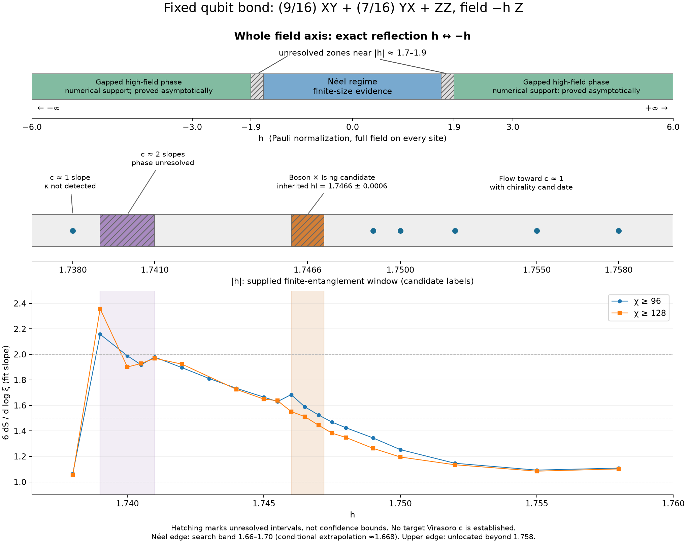

# Field diagram of the fixed simple chirality qubit chain

**A gapped low-field Neel regime and a gapped high-field regime are well
supported. The intervening liquid and chirality transitions remain partly
unresolved; no target Virasoro central charge is established.** This adds
independent exact diagonalization, operator-resolved spectra and a critical
audit of the collaborator's saved finite-entanglement ladders.

The microscopic model is exactly

    H(h) = sum_j [(9/16) X_j Y_(j+1) + (7/16) Y_j X_(j+1)
                   + Z_j Z_(j+1)] - h sum_j Z_j.

It has physical d=2, nearest-neighbour bonds and one-site translation
invariance. All three bond coefficients stay fixed. The field is counted
once per site, including open-chain ends. There are three bond monomials
and one field monomial; only h is varied. With ZZ fixing the common scale,
the nonzero coefficient ratio near h=1.7466 is 16h/7=3.9922. This is the
V4 bond, **not** the separate phase-1.53/p153c model.



## Phase table and evidence status

Use |h| throughout: field reflection is exact. Endpoints below are sampled
support or working search ranges, **not** certified phase boundaries.

| Absolute field or region | Supported interpretation | Evidence / central charge status |
| --- | --- | --- |
| 0 and low fields, sampled through 1.66 | Massive Neel order; two translation-related vacua | [numerical] Very stable order weight and bulk gap; no CFT c assigned |
| 1.66--1.70 | First Neel instability unresolved | [heuristic] First-sector-crossing extrapolation gives about **1.668**; transition type and error bound unknown |
| Between that edge and 1.738 | Candidate intervening liquid | [numerical, incomplete] Small-ring incommensurate wavevector and low gaps; no uniform c assignment |
| 1.738 | One-boson candidate, chirality not detected | [inherited numerical] c_slope=1.065, drifting toward 1 |
| 1.739--1.741 | Persistent apparent c about 2 window | [unresolved] At 1.7405, c_slope=1.919 through chi=320; phase vs point vs crossover/branch artifact not decided |
| 1.741--1.746 | Crossover or additional structure | [unresolved] Entropy slopes drift from about 2 to 1.6; no separate phase assigned |
| 1.7466 +/- 0.0006 | **Boson x Ising candidate** | [inherited numerical] Late-window slopes near 3/2; field estimate uses Ising exponent, and neither independent eta nor a stable Ising velocity is available |
| Around 1.750--1.758 | Chiral one-boson candidate | [inherited numerical] Order magnitude tends to a plateau; c slopes flow toward 1. At 1.750 the high-chi fit is still 1.20--1.25 |
| Above 1.758 to roughly 1.9 | Upper boundary unlocated | [unresolved] Small rings become high-field-like but cannot locate loss of the chiral liquid or exclude another phase |
| Sampled 1.9,2,2.2,2.5,3,4,6; sufficiently large | Massive dressed high-field phase | [numerical] Size-convergent spectra/correlations; [proved using a cited theorem] unique gapped phase exists for sufficiently large |h|, with no explicit threshold |

The inherited +/-0.0006 is a finite-entanglement working estimate, not a
new confidence interval. A weak first-order transition beyond the observed
lengths remains possible. No dimer/bond-ordered thermodynamic phase is
established. The table is also available as [CSV](phase_table.csv).

## Concrete new results

**[proved algebra; numerical implementation checks]** P=product Z and
A=(product_odd Z)K are exact symmetries. C=(product X)K maps h to -h,
reversing magnetization while leaving kappa unchanged. A distinct bipartite
unitary field reversal also exists. Staggered chirality is **P-even,
A-odd and translation-odd**, whereas Neel and ordinary bond order are
A-even. Its diagnostic spectral channel is the ground parity with a
momentum shift pi. The real-frame gauge, its L=2 mod 4 ring seam, full
open-end fields, and Jordan--Wigner parity boundary conditions agree with
independently assembled dense Pauli matrices to **7.2e-15**. See
[derivations and continuum restrictions](THEORY.md).

**[numerical]** At h=0, the Neel-doublet splitting at L=12,16,20 is
3.88e-6, 5.35e-8, 7.70e-10, while the first gap above the doublet stays
2.01555. The normalized Neel weight S_Z(pi)/L is 0.99350, 0.99317,
0.99298. The apparent vanishing first gap is a vacuum splitting, not a
gapless boson. Bond and chirality weights do not show a competing plateau.

**[heuristic extrapolation of new data]** Secants of the first odd-parity
gap at h=1.66 and 1.68 predict finite-ring crossings 1.70336, 1.68790,
1.68053 for L=12,16,20. Assuming 1/L^2 corrections gives intercept
1.66778 (two-size choices 1.66744--1.66802). Those close intercepts do
not bound systematic error, prove a continuous transition or exclude an
earlier instability. The diagram keeps the broader 1.66--1.70 search band.

**[numerical operator evidence]** At h=1.7466 the first kappa-pi-carrying
same-parity gaps are **0.08269, 0.03742, 0.04329** for L=12,16,20.
Their L times gap values are **0.9923, 0.5987, 0.8657**, with no stable
conformal velocity. At L=20 the much smaller opposite-parity gap is
1.55e-5 and does not identify the chiral Ising mode. The connected kappa
correlations change sign even after removing (-1)^r; no power-law exponent
is imposed. Full momentum-block weights and transverse, density, bond
and chiral structure factors are retained. The rings do not resolve the
source's reported roughly 34-site spiral pitch.

**[independent table reanalysis]** The apparent c about 2 at h=1.7405
survives replacing the longest length by the other parity length. Their
ratio near 4.2 is not a velocity ratio. At h=1.740 competing order
orientations remain at energy differences as small as 2.1e-8 per site.
The supplied interacting boson x Ising control gives **c_slope=1.626**,
outside the source's summarized 1.42--1.52 calibration range. Convergence
flags and operator-resolved transfer spectra are absent from the committed
tables. See the [fit windows and source-code audit](LADDER_AUDIT.md).

**[analytic]** Pair creation forbids an exactly saturated all-up/down
ground product at finite h. At large positive h,
e=1-h-1/[4(h-1)]+O(h^-3) and M=1-1/[4(h-1)^2]+O(h^-4).
The high-field phase is a dressed paramagnet. An allowed marginal
density--Ising-energy coupling leaves continuous versus weak first-order
behavior open near the proposed boson x Ising point. Two unequal-velocity
bosons cannot be distinguished from that candidate by entropy alone.

## Reproduction and provenance

Author/AI assistance: OpenAI Codex, GPT-6 family, 2026-11-18; the assignment
requested GPT-6 Astra with Max reasoning. No additional agents or chats
were used. No independent human review is claimed. All new code and
results are confined to this folder; earlier contributions are unchanged.
The original iMPS states were neither available nor regenerated.

Dependencies: Python, numpy, scipy, threadpoolctl; matplotlib for figures.
The run used numpy 2.5.5, scipy 1.18.1 and matplotlib 3.11.2. From the
repository root, with one thread:

```sh
export OPENBLAS_NUM_THREADS=1 OMP_NUM_THREADS=1
python -B contrib/qubit_chirality_field_diagram_20261118/scripts/check_exact.py
python -B contrib/qubit_chirality_field_diagram_20261118/scripts/ladders.py
python -B contrib/qubit_chirality_field_diagram_20261118/scripts/ed.py
python -B contrib/qubit_chirality_field_diagram_20261118/scripts/ed.py --fields 1.64,1.66,1.68,1.76,1.77,1.78 --seconds 90 --output refine.json
python -B contrib/qubit_chirality_field_diagram_20261118/scripts/ed.py --sizes 20 --fields 0,1.66,1.68,1.7466,1.77,1.8 --seconds 420 --output larger.json
python -B contrib/qubit_chirality_field_diagram_20261118/scripts/operator_levels.py
python -B contrib/qubit_chirality_field_diagram_20261118/scripts/operator_levels.py --sizes 20 --fields 1.7466 --output operator_levels20.json
python -B contrib/qubit_chirality_field_diagram_20261118/scripts/audit_results.py
python -B contrib/qubit_chirality_field_diagram_20261118/scripts/report.py
```

The L=20 full-ring batch intentionally stops at its alarm if needed. This
run completed four fields, interrupted h=1.77, and never started h=1.8;
`larger.json` is explicitly incomplete. Completed records survive the stop.
For a targeted repeat of the actual completed data use only
`--fields 0,1.66,1.68,1.7466`. Raw parity energies, rather than translation
projections with a 1e-8 degeneracy tolerance, determine the tiny vacuum
splittings. Only completed eigenpairs enter the results.

There are 50 completed full-ring points, seven operator-resolved points,
and small exact checks. The full-ring batches consumed about 505 seconds,
including the interrupted work; operator blocks took about 28 seconds.
All computation used one worker/thread and explicit size/time caps. No
DMRG, cluster submission, detached job or production restart was launched.
[Registration](REGISTRATION.md) records the adaptive choices; the
[finite-matrix audit](results/audit.json) checks residuals, energy and
structure-factor sum rules, and agreement of independent operator weights.

## Most useful next calculation

**Measure the operator-resolved chirality spectrum and connected chiral
correlator on a verified large-correlation-length state near h=1.7465.**
Recovering the collaborator's existing states and convergence logs makes
this possible before new production. A positive-speed Majorana branch
and an independently fitted unmodulated eta would test the proposed
boson x Ising interpretation much more directly than another entropy
slope. The [minimal protocol](NEXT_RUN.md) specifies resources, competing
branches, oscillatory fits and stopping criteria; it has **not** been run.

[SHARED_SUMMARY.md](SHARED_SUMMARY.md) proposes coordinator-owned status
text. This contribution narrows the scientific uncertainties and adds
new finite-size evidence, but does not publish a microscopic c>1 theorem
or a completed thermodynamic phase diagram.
